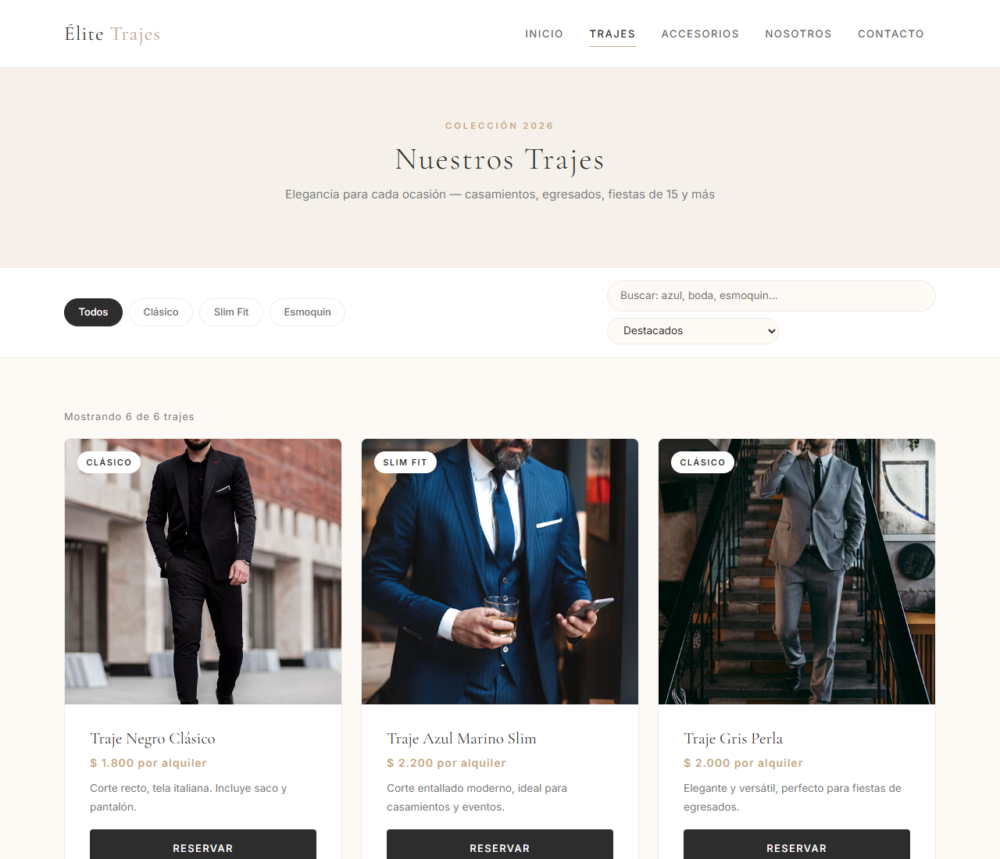
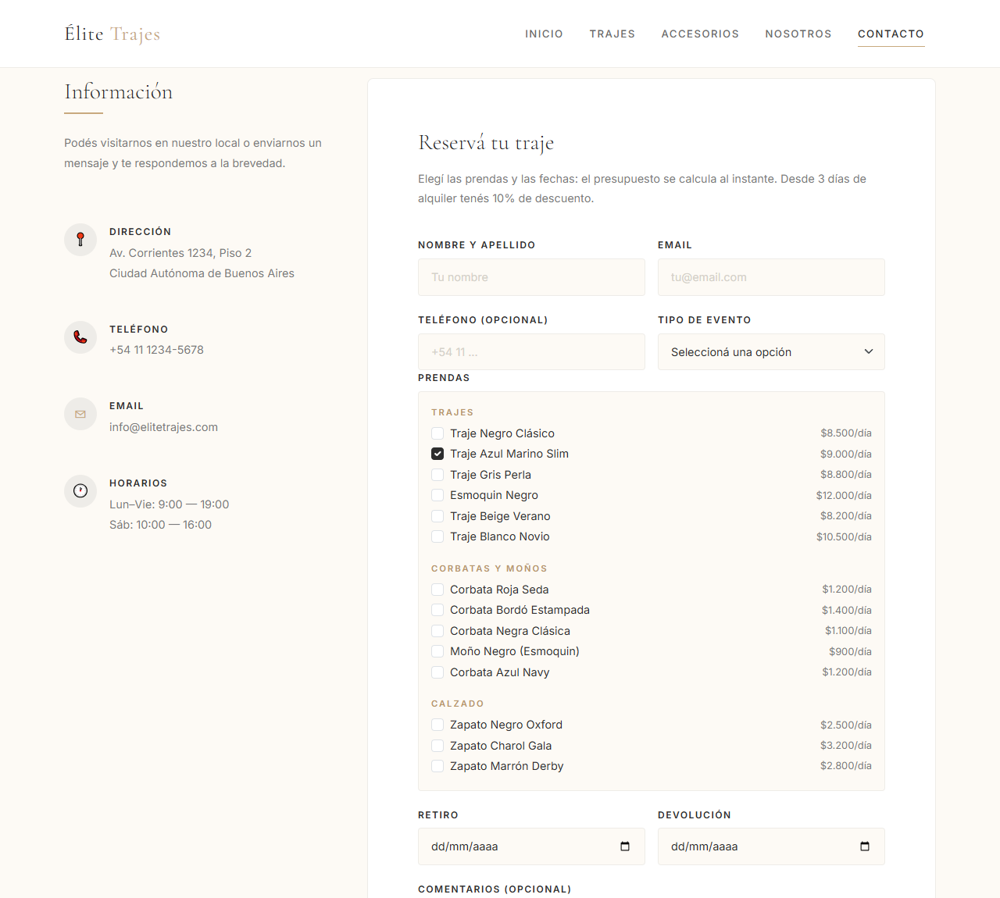

# Élite Trajes 🤵

Sitio web de una casa de alquiler de trajes, con catálogo filtrable y simulador de reservas con presupuesto en vivo.
Hecho con HTML, Sass, Bootstrap 5 y JavaScript sin frameworks, y probado con tests unitarios y de navegador.

[](https://github.com/Facundo-RC/EliteTrajes/actions/workflows/ci.yml)

**[Ver la demo](https://facundo-rc.github.io/EliteTrajes/)** · Autor: **Facundo Robaño** — [LinkedIn](https://www.linkedin.com/in/facundo-roba%C3%B1o-1b584221b) · [GitHub](https://github.com/Facundo-RC)

| Catálogo con filtros | Reserva con presupuesto |
|---|---|
|  |  |

La interfaz es responsiva: en el celular los filtros se apilan y la grilla pasa a una columna ([captura](docs/captura-celular.png)).

---

## Qué se puede hacer

- **Buscar trajes** por estilo (clásico, slim fit, esmoquin), por texto —sin importar tildes ni mayúsculas— y ordenarlos por precio o nombre. Si no hay coincidencias, el sitio lo avisa y ofrece limpiar los filtros.
- **Ver accesorios** separados en corbatas y calzado, con pestañas.
- **Reservar**: el botón *Reservar* de cada prenda abre el formulario con esa prenda ya elegida. Al sumar prendas y fechas, el presupuesto se recalcula al instante. Como en las casas de alquiler de Montevideo, el precio es por alquiler e incluye hasta 3 días; cada día de más suma un 10%.
- **Validación clara**: cada campo muestra su propio error, el foco va al primero que falla, y no se puede retirar en una fecha pasada, devolver antes de retirar ni alquilar más de 14 días.
- **Reservas guardadas**: al confirmar se genera un código (por ejemplo `ET-7K2QX`). La reserva queda guardada en el navegador, sigue ahí al recargar y se puede cancelar.

> Es un sitio de demostración: no hay servidor, así que las reservas se guardan sólo en el `localStorage` del navegador.

## Stack

| Parte | Tecnología |
|---|---|
| Maquetado | HTML5 semántico, Bootstrap 5.3 |
| Estilos | Sass con módulos (`@use`), arquitectura por capas y metodología BEM |
| Lógica | JavaScript ES6+ en módulos, sin frameworks |
| Datos | `data/productos.json`, cargado con `fetch` |
| Tests | `node:test` para la lógica, Playwright para el navegador |
| Integración continua | GitHub Actions |

## Cómo está organizado

```
EliteTrajes/
├── index.html, pages/       Las cinco páginas del sitio
├── data/productos.json      Los 14 productos: trajes, corbatas y calzado
├── js/
│   ├── catalogo.js          Filtrar, ordenar y formatear (lógica pura)
│   ├── reserva.js           Días, presupuesto y validación (lógica pura)
│   ├── dom.js               Utilidades de interfaz compartidas
│   └── trajes.js, accesorios.js, contacto.js   Una por página: dibujan y escuchan eventos
├── sass/
│   ├── utilities/           Variables, mixins y listas
│   ├── base/                Reset y estilos base
│   ├── components/          Accesibilidad, catálogo y formulario de reserva
│   ├── layout/              Header, footer y media queries
│   └── pages/               Estilos propios de cada página
├── css/main.css             El CSS compilado que usa el sitio
└── tests/                   Tests de lógica y, en e2e/, de navegador
```

**Decisión de diseño:** la lógica (`catalogo.js` y `reserva.js`) no toca el DOM. Por eso se puede testear con Node sin abrir un navegador, y los scripts de cada página sólo se ocupan de dibujar y responder a eventos.

Las tarjetas se arman con `createElement` y `textContent`, nunca con `innerHTML`, así ningún dato se interpreta como HTML.

## Pruebas

| Tipo | Cantidad | Qué cubre |
|---|---|---|
| Lógica (`npm test`) | 34 | Integridad de los datos, filtros, búsqueda con tildes, orden, cálculo de días (cambios de mes y de año), presupuesto con días incluidos y recargo por días extra, validación de cada campo, valores límite (hoy, 14 y 15 días) |
| Navegador (`npm run test:e2e`) | 18 × 2 dispositivos | Flujos completos en escritorio y en celular: filtrar, buscar, ordenar, pestañas, presupuesto, errores del formulario, confirmar, recargar y cancelar una reserva, sin errores de JavaScript y sin scroll horizontal |

GitHub Actions corre las dos suites en cada push y además verifica que `css/main.css` esté compilado desde el Sass actual.

Las pruebas encontraron dos bugs, y cada uno quedó corregido y cubierto por un test:

- En pantallas de 375 px las pestañas de accesorios se salían del ancho (ya pasaba antes de este trabajo).
- Al tocar *Reservar*, la barra de navegación fija tapaba el comienzo del formulario. Se resolvió con `scroll-padding-top`.

## Accesibilidad

- Enlace para saltar al contenido, `<main>` en cada página y foco visible con teclado.
- Etiquetas en todos los campos, errores asociados con `aria-describedby` y `aria-invalid`.
- Filtros y pestañas con `aria-pressed`, contador de resultados con `aria-live`.
- Respeta la preferencia del sistema de reducir animaciones.

## Cómo correrlo

El sitio carga los datos con `fetch`, así que necesita un servidor local (abrir el `index.html` con doble clic no alcanza).

```bash
git clone https://github.com/Facundo-RC/EliteTrajes.git
cd EliteTrajes
npm install

npx http-server . -p 4173     # o la extensión Live Server de VS Code
```

Y abrir `http://localhost:4173`.

| Comando | Qué hace |
|---|---|
| `npm run watch` | Recompila el Sass al guardar |
| `npm run build` | Compila el Sass minificado a `css/main.css` |
| `npm test` | Corre los tests de lógica |
| `npm run test:e2e` | Corre los tests de navegador (la primera vez: `npx playwright install chromium`) |

## Créditos

Fotos de [Unsplash](https://unsplash.com).

La marca y los datos de contacto son ficticios, aunque el local se ubica en Montevideo. Los precios están en pesos uruguayos y toman como referencia los valores de alquiler de trajes publicados para Montevideo en 2026 (de $ 1.200 a $ 1.800 un traje básico, hasta $ 3.000 un corte moderno y más para los de diseñador). Los de esmoquin y accesorios son estimados.

## Licencia

[MIT](LICENSE)
